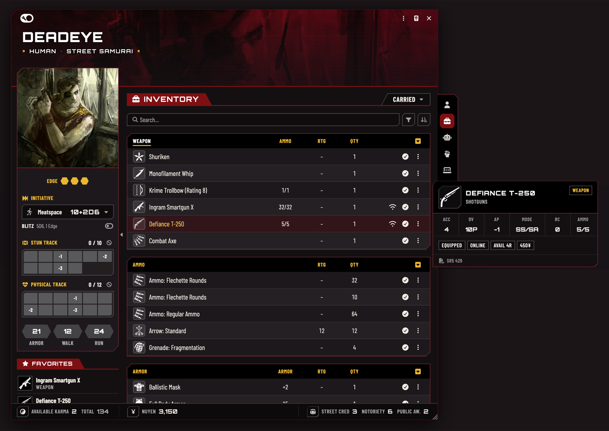
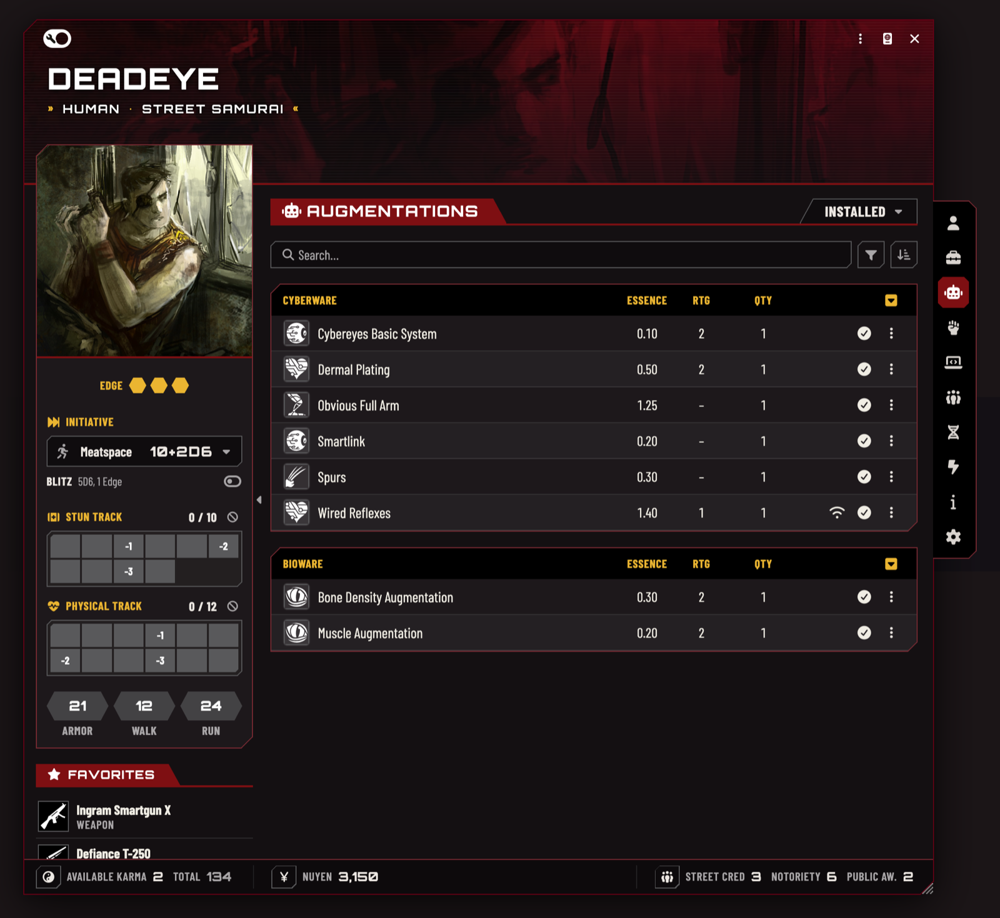
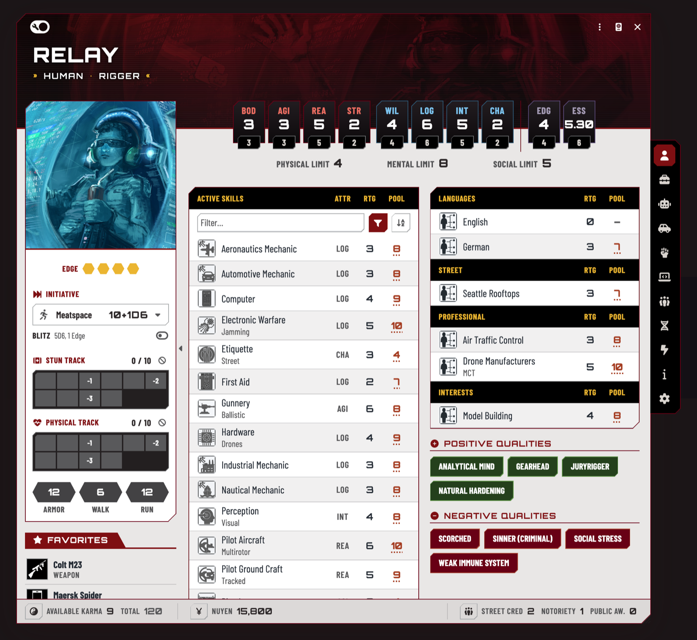

# SR5 Redesign: Foundry VTT module for the Shadowrun 5e system

[](https://github.com/Vorfale/sr5-redesign/releases/latest)
[](https://github.com/Vorfale/sr5-redesign/releases)
[](https://foundryvtt.com)
[](https://github.com/SR5-FoundryVTT/SR5-FoundryVTT)
[](https://discord.gg/qfudBfuPG3)

A redesign of the whole interface of the [Shadowrun 5e system](https://github.com/SR5-FoundryVTT/SR5-FoundryVTT) for
[Foundry VTT](https://foundryvtt.com): sheets, windows and the way you work with them.

> Requires the Shadowrun 5e system. An unofficial fan module: it leaves the system and your data untouched, and
> turning it off brings back the system's own sheets.


## What it does

SR5 Redesign tries to make the system's sheets more comfortable to play with:

- the mechanics and buttons you use most sit **where you can see them**: initiative, condition monitors, armor and the
  quick rolls with their dice pools, together in one sidebar;
- **tables are easier to read**, and skills show their dice pool next to the rating;
- lists get **filters and sorting**, which the system's sheet doesn't have;
- the sheet **looks and feels like the rulebooks**, in a dark and a light theme;
- **hints** where they were missing, like the modifier breakdown behind a number and a link to the rulebook page;
- some content is **split by meaning**, like augmentations apart from the inventory;
- what you usually miss when playing a character is on the sheet, like their **vehicles and drones**;
- some **pop-ups are reworked**: the karma, nuyen and reputation managers, the network manager.

The first goal is a better overall experience: quality-of-life improvements all over the sheet, and a sheet that feels
like Shadowrun.

**On the way to 1.0:**

- [x] character sheet
- [x] vehicle and drone sheet
- [ ] matrix actors, spirits, critters and NPCs
- [ ] items
- [ ] roll dialogs and chat cards

<details>
<summary>Everything on the sheet, in detail</summary>

- Header: name, metatype and archetype, limits, and the character's art as a banner, moved and zoomed to frame it.
- Attribute plates with modifier cards; Edge and Essence.
- Sidebar: initiative modes and Blitz, condition monitors with wound modifiers and overflow damage as a third monitor,
  armor and movement, quick rolls (Defense, Soak, Composure, Judge Intentions, Memory, Lift/Carry, Drain or Fading)
  with their pools, favorites, running silent and the PAN; collapsible.
- Skills with pools; the text filter plus filter menus (trained or untrained, attribute, skill group); play mode lists
  trained skills.
- Inventory, augmentations, actions and magic: search, filter menus and a sort button; every table header sorts its
  column, remembered per user.
- Hover cards for items, skills, attributes, limits, armor and movement.
- Expanded rows: an item's properties in one line with icons, its rulebook source, the Matrix condition monitor.
- Favorites in the sidebar: drop any item on them, drag to reorder. A ⋮ menu button in every row.
- Matrix: the device as a card with its attributes swapped on it, actions grouped by limit, network, marked and owned
  icons.
- An update redraws only what changed; hidden tabs are drawn when the browser is idle. Sheets reopen at the size you
  last gave them.
- A per-user Readable text setting; Latin and Cyrillic text.

</details>

## Get involved

[](https://discord.gg/qfudBfuPG3)

Questions, ideas and table stories are welcome on [Discord](https://discord.gg/qfudBfuPG3). Found a bug? Open an
[issue](https://github.com/Vorfale/sr5-redesign/issues) with the Foundry, system and module versions, what you did and
what you saw; a screenshot and the browser console (F12) help a lot.

## Screenshots

<table>
<tr>
<th>Inventory and hover card</th>
<th>Augmentations</th>
</tr>
<tr>
<td><a href="media/character-inventory-card.png"></a></td>
<td><a href="media/character-augmentations.png"></a></td>
</tr>
<tr>
<th colspan="2">Light theme</th>
</tr>
<tr>
<td colspan="2"><a href="media/character-light.png"></a></td>
</tr>
</table>

## Install

Install it on the machine that **hosts** the game; players who connect get it automatically.

1. In Foundry VTT: **Add-on Modules → Install Module**, paste this into **Manifest URL** and press **Install**:

   ```
   https://github.com/Vorfale/sr5-redesign/releases/latest/download/module.json
   ```

2. Open the world, **Game Settings → Manage Modules**, enable **SR5 Redesign**.
3. Characters open in **SR5 Redesign (experimental)**. A character set to a particular sheet keeps it: header menu
   **Sheet** → SR5 Redesign.

<details>
<summary>Update, remove, install by hand</summary>

- **Update:** **Add-on Modules → Check for Updates**, then reload the browser with the cache bypassed (Ctrl+F5 /
  Cmd+Shift+R).
- **Remove:** disable the module; characters go back to the system's sheet.
- **By hand:** download `module.zip` from [Releases](https://github.com/Vorfale/sr5-redesign/releases) and unzip it
  into `Data/modules/sr5-redesign/`.

</details>

## Compatibility

| | Required | Checked with |
|---|---|---|
| Foundry VTT | v14 | 14.369 |
| Shadowrun 5e system | 0.37 | 0.37.8 |

A newer system version may need a new version of the module. UI skins such as Carolingian UI can be used alongside.

## Credits and license

Built on the [Shadowrun 5e system for Foundry VTT](https://github.com/SR5-FoundryVTT/SR5-FoundryVTT). Fonts under the
SIL Open Font License, icons from Font Awesome Free, Fuse.js under Apache-2.0. Screenshots: concept art by David Revoy /
Blender Foundation for Tears of Steel, [CC BY 3.0](https://creativecommons.org/licenses/by/3.0/)
([source](https://commons.wikimedia.org/wiki/Category:Concept_art_by_David_Revoy_for_Tears_of_Steel)), cropped and
tinted by the sheet. Details in the [fonts notice](fork/public/fonts/README.md) and in `THIRD-PARTY-NOTICES.md` inside `module.zip`.

SR5 Redesign, copyright (C) 2026 Ravefale, is free software under the [GNU General Public License version 3](LICENSE),
without any warranty; it contains code from the Shadowrun 5e system, changed for this module.

Shadowrun is a registered trademark and/or trademark of The Topps Company, Inc. This is an unofficial fan work, not
affiliated with or endorsed by The Topps Company, Catalyst Game Labs or Foundry Gaming.
