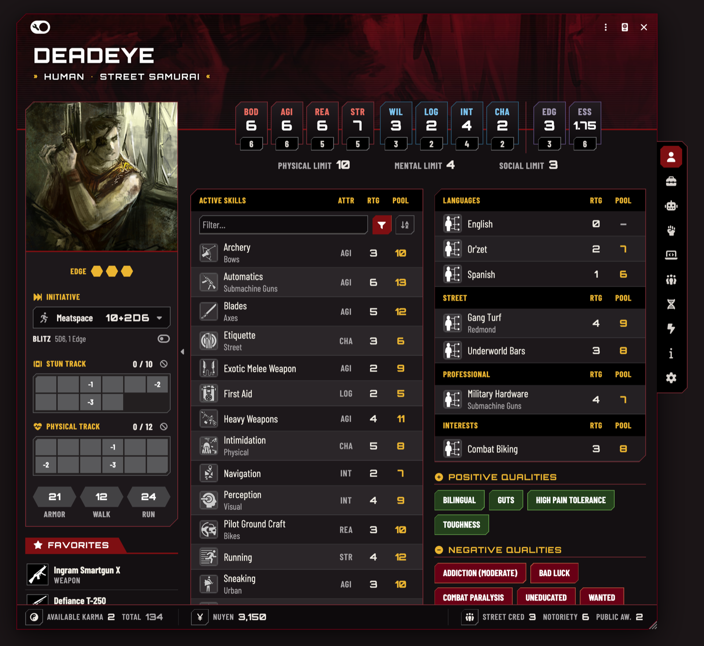

# SR5 Redesign



An unofficial redesign of the **Shadowrun 5e** system's sheets for Foundry VTT v14. It adds new sheets and leaves the
system and its data alone; the system's own sheets stay available. Turn the module off and characters go back to the
system's sheet.

Today it covers the **character sheet** and the **vehicle and drone sheet**, with the windows they open (karma, nuyen and
reputation managers, the network manager). The goal for 1.0 is the whole interface: matrix actors, spirits, critters and
NPCs, items, roll dialogs and chat cards.

## What it is for

**A sheet that looks like the books.** The colours were measured from the SR5 rulebooks: dark pages with gold accents,
and a light theme as well. Headings, plates and tables take their cues from the books, set in free fonts picked to stand
in for the books' typefaces (Orbitron, Barlow Condensed, Marcellus). Cyrillic text keeps the look through free
look-alike fonts.

**Less clicking at the table.**
- Combat in one sidebar: initiative and Blitz, condition monitors with wound modifiers and overflow damage, armor,
  movement and quick rolls (Defense, Soak, Composure, Judge Intentions, Memory, Lift/Carry, Drain or Fading), each with
  its dice pool shown.
- Skills show their pools. Play mode lists trained skills; search and filters (attribute, skill group, trained or
  untrained) find the rest.
- Inventory, augmentations, actions and magic have search, filters and sorting; every table header sorts its column,
  remembered per user.
- Hover cards for items, skills, attributes, limits, armor and movement, with the modifier breakdown where a value has
  modifiers and a link to the rulebook page.
- Favorites: drop an item on the favorites, drag to reorder.
- A ⋮ menu in every row; sheets open at the size you last gave one.

**Something to look at.** The character's art as a banner in the sheet header, moved and zoomed to frame it. The
vehicle and drone sheet shares the look, with a portrait or the token picture.

**Quick to use.** An update redraws only what changed: a damage box, Edge, karma or an item toggle costs about a third
of a full render. Hidden tabs are drawn when the browser is idle or when you open them, and the first sheet after a page
load opens faster.

**Easier to read.** A per-user **Readable text** setting makes the condensed type a weight heavier and slightly wider. On
smaller screens the sheet keeps its margins and the attribute plates stay readable down to Foundry's minimum window
size.

More pictures: [inventory with a hover card](media/character-inventory-card.png),
[augmentations](media/character-augmentations.png), [light theme](media/character-light.png). The characters are test
characters; their pictures are concept art by David Revoy for the Blender Foundation's open movie Tears of Steel
(see Credits).

## In detail

- Header: name, metatype and archetype, limits, sheet art.
- Attribute plates with modifier cards; Edge and Essence (whole numbers without decimals).
- Sidebar: initiative modes and Blitz, condition monitors with wound modifiers, armor and movement, quick rolls
  (Defense, Soak, Composure, Judge Intentions, Memory, Lift/Carry, Drain or Fading) with their pools, favorites,
  running silent and the PAN; collapsible.
- Skills with pools; search and a filter menu (trained / untrained, attribute, skill group). Play mode lists trained
  skills, edit mode all of them.
- Inventory, augmentations, actions and magic: search, filter menus (magic: by damage element too) and a sort button
  (sheet order, name A–Z, Z–A); every table header sorts its column, remembered per user. Rich hover cards for items,
  skills, attributes, limits, armor and movement, with a link to the rulebook page.
- Expanded rows: an item's properties in one line with icons, its rulebook source at the top right, the Matrix
  condition monitor on a line of its own. A ⋮ menu button in every row.
- Favorites: drop an item row (or any item) on the favorites to add it; drag to reorder.
- Overflow damage as a third condition monitor under the physical track.
- Matrix: device card with swappable attributes, actions grouped by limit, network / marked / owned icons.
- Footer: karma, nuyen, street cred, notoriety, public awareness.
- Dark and light themes (the sheet's own theme in Configure Sheet, or Foundry's).
- Latin and Cyrillic text: the sheet fonts have no Cyrillic, so free look-alikes fill in for Cyrillic letters only.

## Install

Foundry modules live on the server, so install it on the machine that **hosts** the game. Players who connect get it
automatically.

1. In Foundry VTT: **Add-on Modules → Install Module**, paste this into **Manifest URL** and press **Install**:

   ```
   https://github.com/Vorfale/sr5-redesign/releases/latest/download/module.json
   ```

2. Open the world, **Game Settings → Manage Modules**, enable **SR5 Redesign**, save (the world reloads).
3. Characters open in **SR5 Redesign (experimental)** from then on. A character that was set to a particular sheet
   keeps it: header menu **Sheet** (Configure Sheet) → choose SR5 Redesign.

To remove: disable the module; characters go back to the system's sheet.

Updating: **Add-on Modules → Check for Updates** in Foundry. Then reload the browser with the cache bypassed
(Ctrl+F5 / Cmd+Shift+R) so the new stylesheet and fonts are fetched.

Without the manifest: download `module.zip` from [Releases](https://github.com/Vorfale/sr5-redesign/releases) and unzip
it into `{Foundry user data}/Data/modules/sr5-redesign/`, so that you get `Data/modules/sr5-redesign/module.json`.

UI skins such as Carolingian UI restyle every heading, tooltip, window header and context menu from their own
stylesheet; the sheet, its tooltips and the windows it opens keep their own type and layout against that (0.3.1).

## Compatibility

- Foundry VTT v14 (checked with 14.369).
- Shadowrun 5e system 0.37 (checked with 0.37.8). The module carries the parts of the system code it needs, built from
  that release. Other 0.37 releases are allowed but not checked. A newer system version prints a warning in the browser
  console (F12) and may need a new version of the module.

## Credits and licenses

- Sheet logic builds on the Shadowrun 5e system for Foundry VTT, GPL-3.0 — https://github.com/SR5-FoundryVTT/SR5-FoundryVTT,
  and the script contains parts of it. This module is GPL-3.0 as well (see LICENSE).
- Fonts, all under the SIL Open Font License 1.1: Orbitron, Barlow Condensed, Marcellus, and the Cyrillic look-alikes
  Days One, Sofia Sans Condensed, Forum. The files are the original releases from the Google Fonts repository, packed
  into WOFF2 without any change; `fonts/README.md` lists authors, sources and checksums, and each font's `OFL.txt` is
  next to it.
- Bundled code from npm: Fuse.js (Apache-2.0); its copyright and license are in `THIRD-PARTY-NOTICES.md`.
- Icons: Font Awesome Free, from Foundry's own copy. Row pictures come from the installed system (some by Bella
  Carvalho, CC BY-SA 4.0, as the system's README credits them).
- Screenshots (`media/`, not part of the module): the portraits and header art are concept art by David Revoy /
  Blender Foundation for Tears of Steel, CC BY 3.0 (https://creativecommons.org/licenses/by/3.0/): "Celia - killer bots,
  streets" and "Genghis Jones - pod active" (https://commons.wikimedia.org/wiki/Category:Concept_art_by_David_Revoy_for_Tears_of_Steel),
  cropped and resized, and tinted by the sheet's header.
- Colours were measured from the SR5 rulebooks. No Catalyst Game Labs or Topps art or logos are included.

## License

SR5 Redesign, copyright (C) 2026 Ravefale, is free software under the GNU General Public License version 3 (`LICENSE`),
without any warranty. It contains code from the Shadowrun 5e system for Foundry VTT, copyright its authors, also
GPL-3.0, changed for this module. Source code: https://github.com/Vorfale/sr5-redesign.

Shadowrun is a registered trademark and/or trademark of The Topps Company, Inc. This is an unofficial fan work, not
affiliated with or endorsed by The Topps Company, Catalyst Game Labs or Foundry Gaming.
